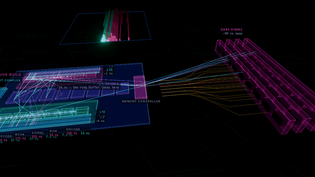
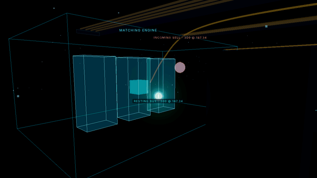
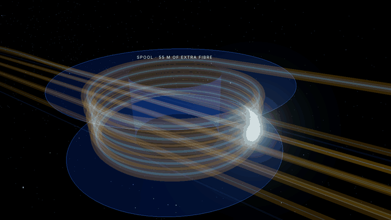
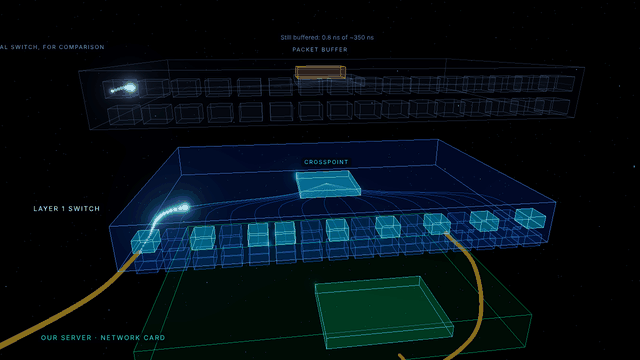
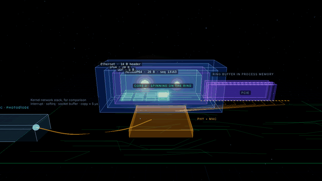
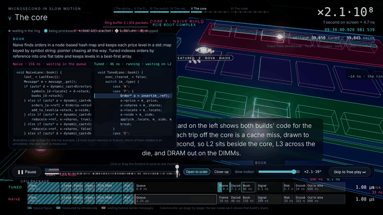

# Microsecond in Slow Motion

**Watch one market data packet become a trade.**

<!-- LIVE DEMO: once deployed, replace the line below with the real link, e.g.
**[▶ Watch it live](https://your-deployment.example.com)** -->
**▶ Live demo: link coming soon**



This project follows a single Nasdaq TotalView-ITCH packet from the exchange's matching engine, down 100 metres of fibre, through a layer 1 switch and a network card, into a CPU core, and out again as an order. It plays as a Three.js film in five acts, and every nanosecond spent in our own software is measured, not animated.

The software is real. `mmdecode` is a C++ ITCH decoder that runs two builds of the same trading pipeline side by side. The naive lane is the idiomatic version: polymorphic heap-allocated messages, `std::map` books keyed by strings, and orders built with `std::string`. The tuned lane is what a latency engineer would write: fixed-offset loads, a flat order table, best-first level arrays and a pre-filled order template. Both read the same feed and must reach the same decisions; the decoder warns and exits with a non-zero status if they ever disagree. Every stage of every message is timed with `rdtsc`, and where the machine allows it, hardware counters record the cache misses and branch mispredicts behind each stall.

The slow-motion factor is always on screen. It runs from real time, where a burst at the open is a solid beam, down to a billion times slower, where a single 90 ns trip to DRAM lasts a minute and a half.

## The five acts

### I. The exchange



A data centre hall, rows of trading firms' racks and the one machine that matters. Inside the matching engine an incoming sell meets a resting buy, and the execution leaves as a multicast ITCH packet bound for every subscriber at once.

### II. The fibre



The camera rides alongside the light through our 100 metre cross-connect, at 4.9 ns a metre. On the way it loops round a spool of extra fibre: exchanges give every firm the same cable length, so being close buys nothing.

### III. The switch



A layer 1 switch never reads the packet. It repeats the signal to every subscribing port in five nanoseconds, while a conventional switch above it is still taking the frame into its buffer.

### IV. The network card



Light becomes current. The Ethernet, IP and UDP headers peel off, the MoldUDP64 packet opens, and its ITCH messages are written over PCIe straight into a ring buffer in our process's memory, where one core spins waiting for them. A ghost route shows the kernel network stack taking about 5 µs to do the same.

### V. The core



The naive and tuned lanes process the same packet on the same machine. Cache misses drop into wells below the pipeline whose depth is proportional to latency (L2, L3, DRAM), and branch mispredicts shatter and rewind. A receipt along the bottom totals tick to trade for both lanes, segment by segment.

Alongside, a code card shows the naive and tuned source for whichever stage our message is in. The snippets are cut from `decoder/src` at build time, so they are always the code that was measured. During a stall, the lines that touch memory light up in the colour of the level being waited on. Which line stalled is an annotation, since the counters are per stage, not per line.

The act ends in free play: a slow-motion slider from real time to ×10⁹, overview, follow, wells and order book cameras, a jump to the next order, and a per-message breakdown of every stage in both lanes.

## Running it

You need a C++17 compiler, CMake, Python 3 and Node 20.19 or later.

```sh
make            # builds the decoder, generates synthetic ITCH, writes web/public/trace.bin, builds the site
make dev        # serves the viewer at http://localhost:5173
```

A trace from the synthetic feed is committed in `web/public/trace.bin`, so `cd web && npm install && npx vite` is enough to watch it without building anything.

| Control | What it does |
|---|---|
| Space | pause and resume |
| ← → or 1 to 5 | change act |
| F | toggle the follow camera |
| N | jump to the next order (free play) |
| H | hide the overlay for a clean recording |
| R | replay from the start |

A few URL parameters help with demos and recordings:

| Parameter | Effect |
|---|---|
| `?trace=synthetic` | use a trace generated in the browser, with illustrative counter values; useful for showing branch mispredicts on a machine without hardware counters |
| `?act=5&beat=tuned&advance=4` | open an act at a named beat and fast-forward a few seconds (beat names are in each act's script) |
| `&hud=0` | start with the overlay hidden |

## Using real Nasdaq data

Nasdaq publishes sample TotalView-ITCH 5.0 files covering full trading days. They are several gigabytes each, so cut out the window you want first. The slicer replays everything before the window to rebuild the live books, then writes those orders as Add Order messages ahead of the window, so the books are correct from the first message.

```sh
tools/fetch_itch.sh 01302019.NASDAQ_ITCH50.gz
python3 tools/slice_itch.py data/01302019.NASDAQ_ITCH50.gz --start 09:29:59.950 --ms 200 --out data/open.itch
make trace ITCH=data/open.itch DECODE_FLAGS="--hero AAPL --cpu 3"
```

Leave out `--symbols` on the slicer to keep the whole market, which gives a much better beam at real time. Slicing a full day in Python takes several minutes.

## How the measurements work

`mmdecode` repackages the historical file into MoldUDP64 packets, grouping messages that arrived within 500 ns of each other, so the decoder sees real framing. Each lane is run from a fresh start several times (`--repeat`, default 3) with `rdtsc` around every stage, and the fastest time for each message and stage is kept. The probe overhead, measured up front, is subtracted.

When `perf_event_open` is available, a separate pass reads four counters per stage with `rdpmc`: L1D read misses, LLC references, LLC misses and branch misses. Timing and counting are separate passes because reading counters perturbs the timing. The viewer turns the counts into stalls at the right level of the hierarchy. Where a stall falls within a stage, and how long each one is drawn, is illustrative: the totals come from the hardware, but misses overlap, so the drawn stalls are scaled to fit inside the measured stage time.

Without counters (in a VM or container, or with `--no-counters`), the viewer infers stalls from how far each stage's time sits above that stage's typical time, and says so in the corner of the screen. Branch mispredicts cannot be inferred that way and are not shown.

The viewer schedules each lane as a single core: a message starts once it has arrived and the previous message has finished, with arrival times taken from the exchange timestamps. That is how the naive lane builds a queue during a burst while the tuned lane keeps up. The decoder picks "our" message from inside such a burst unless you choose one with `--hero-message`.

Everything outside our software (fibre, switch, network card, PCIe and the transmit path) uses typical published figures from `web/src/journey.js`. The receipt hatches those segments so nobody mistakes them for measurements. Change them to match your own setup.

For the cleanest numbers, run on bare metal with the decoder pinned to an isolated core (`--cpu`), and set `kernel.perf_event_paranoid` to 2 or lower so user-space counters are allowed.

## Deploying

The viewer is a static site with relative paths, so it can be served from any host or subdirectory. `make web` writes it to `web/dist`, trace included; upload that folder to GitHub Pages, Netlify, Cloudflare Pages or any static host. Once it is live, put the link in the placeholder at the top of this file.

To swap in a different trace, run `make trace` before `make web`, or drop a `trace.bin` into `web/dist` after building.

## Regenerating the GIFs

With `npx vite preview` running in `web/` and Playwright and Pillow installed, `node tools/capture_gifs.cjs docs/media` steps the film frame by frame and rewrites the clips above. Each clip's starting beat and length are listed at the top of the script.

## Layout

| Path | What it is |
|---|---|
| `decoder/` | `mmdecode`: feed loading, the two lanes, probes and the trace writer |
| `tools/` | synthetic ITCH generator, Nasdaq fetch and slice scripts, GIF capture |
| `web/src/acts/` | one module per act |
| `web/src/core/` | the Act V pipeline renderer and order book terrain |
| `web/src/code.js` | the code card, cut from the decoder source at build time |
| `web/src/timing.js` | turns a trace into per-lane schedules and stall events |
| `docs/trace-format.md` | the binary format the decoder writes and the viewer reads |
